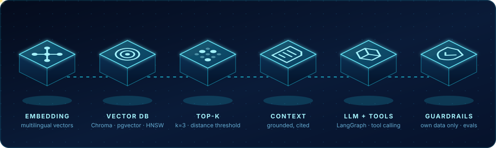
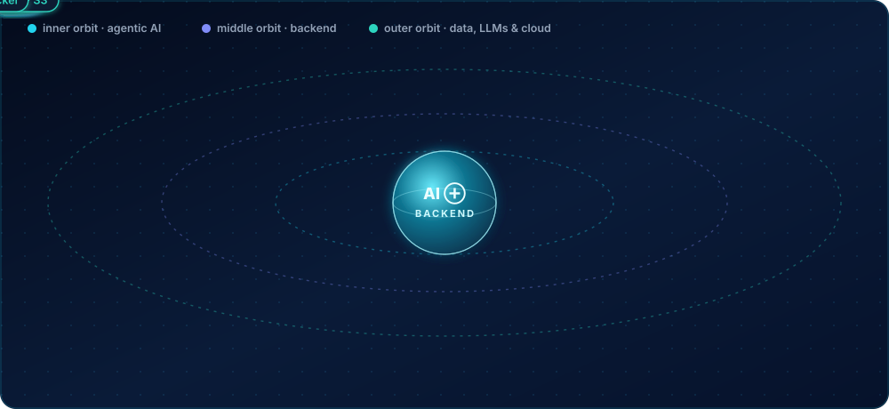

  

  
  
  
  
  

### ⚡ Impact

### 🧠 How I build AI systems

<table>
<tr>
<td width="50%" valign="top">

#### 🏗️ Backend

- Order, inventory, returns and procurement platforms on **FastAPI**, **Django REST**, **PostgreSQL** and **MongoDB**
- Paper warehouse process → digital workflow: **7 days → 1 day** across **12 sites**
- Slow APIs **9 s → 1.3 s** and **8.7 s → 0.34 s** (N+1 fixes, composite indexes, Redis caching)
- Fixed a production race condition with **atomic conditional updates**
- **RabbitMQ** workers, **Socket.IO** live updates, JWT + bitmask RBAC cached in **Redis**
- Zoho, Shiprocket and Delhivery integrations with retries; scheduled **AWS Lambda** token refresh

</td>
<td width="50%" valign="top">

#### 🤖 Agentic AI

- **Production WhatsApp agent for farmers** (team of three): LangGraph, Llama 3.3 70B, allow-listed tools
- **RAG** over the catalogue and FAQs: recursive chunking, multilingual embeddings, Chroma, background re-index
- **Guardrails**: the model only ever sees the current customer's data; human handoff on request
- **Evaluation** set of ~50 real questions + injection attempts, run before every change
- **Fallback** across providers on rate limits or free-credit quota
- **Warehouse chatbot** (end to end): a small model extracts intent, code checks permissions and answers from the DB

</td>
</tr>
</table>

### 🛰️ Skills

<b>Full skill list</b>

 

| Area | Skills |
|---|---|
| **Languages** | Python, SQL |
| **Agentic AI** | LangGraph, LangChain, RAG, tool calling, structured output, prompt engineering, guardrails, LLM evaluation, LangSmith tracing |
| **LLMs** | Llama 3.3 70B, Llama 3.1 8B, gpt-oss (Groq), GPT-4o-mini, multi-provider fallback |
| **Vector search** | Chroma, pgvector, multilingual sentence embeddings, HNSW, chunking strategies |
| **Backend** | FastAPI, Django, Django REST Framework, Pydantic, Celery, REST APIs, webhooks |
| **Databases** | PostgreSQL, MongoDB, MySQL, Redis · schema design, indexing, query optimisation, migrations |
| **Messaging & real time** | RabbitMQ, Socket.IO, Firebase Cloud Messaging, WhatsApp Business API |
| **Security** | JWT, role-based access control, API permissions |
| **Cloud & DevOps** | AWS Lambda, AWS S3, AWS EC2, Docker, Linux, Git, Render |
| **Integrations** | Zoho Books, Zoho CRM, Shiprocket, Delhivery |

</td>
</tr>
</table>

### 📜 Experience & education

| | |
|---|---|
| **Backend Software Engineer** · Katyayani Organics, Bhopal | Oct 2024 – Present |
| **Web Development Intern** · VeriTech Software IT Services | May 2024 – Jun 2024 |
| **B.Tech, Information Technology** · RGPV Bhopal · CGPA 7.9 | 2020 – 2024 |

🏆 Ksolves AI Hackathon 2026 participant · 💻 200+ DSA problems on GeeksforGeeks · ⭐ HackerRank 4★ in Python and SQL

Bhopal, India · open to relocation · <code>while True: build(reliable_backends + useful_ai)</code>

